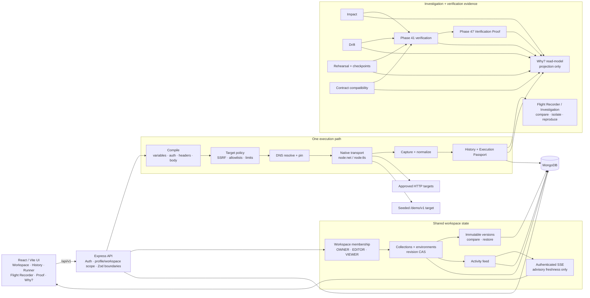
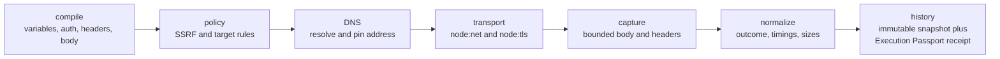
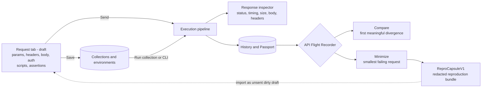

<h1 align="center">Tracer — API Flight Recorder</h1>

<p align="center">
  <strong>API execution, investigation, and change-verification workspace.</strong><br />
  Compose, send, and organize API requests — then investigate failures, understand what a change affects, and verify an affected workflow before you trust it.
</p>

Tracer is a full-stack React and Express application. Requests execute through the Express API on the server and results are persisted in MongoDB, so a signed-in profile can build a real HTTP request, send it, inspect the response, save it into a collection, switch environments, and reopen it from history.

## Reviewer in 60 seconds

**Tracer is an API execution, investigation, and change-verification workspace.** The request builder is the substrate; the differentiator is the evidence system around each execution.

```text
Execute → Understand → Compare → Verify
   \____________ Why? ____________/
```

- **Execute** sends a real request through one backend-owned transport pipeline.
- **Understand** records an immutable, secret-redacted Execution Passport and supports evidence-driven investigation.
- **Compare** explains what changed and what is affected without promoting correlation into causation.
- **Verify** rehearses the affected workflow, checks compatibility, and produces a tamper-evident proof.
- **Why?** is a read-only projection over the evidence already produced by those systems. It creates no new truth.

**Collaborate** is the shared-state layer around that workflow: separate accounts can work in the same workspace, see saved changes live, inspect immutable version history, and resolve concurrent edits through backend CAS instead of silent merging.

The signature verification story is:

```text
edit → snapshot identity → impact → drift → rehearse → contract → verify → proof
```

Clicking **Why?** explains the same result as an evidence chain:

```text
configuration → execution → impact → drift → rehearsal → contract → verification → proof
```

### Truth ownership

Tracer deliberately keeps authority out of React. The UI renders backend-owned evidence and fails closed when evidence is missing.

| Question | Authoritative source |
| --- | --- |
| What configuration actually executed? | Request compiler + immutable execution receipt |
| What happened on the wire? | Execution pipeline + history / Execution Passport |
| What changed or is affected? | Change-impact evidence (Phase 39) |
| What differs across environments? | Drift evidence (Phase 40) |
| What was rehearsed? | Rehearsal plan/run/checkpoints (Phase 46) |
| Is the response contract compatible? | Contract compatibility (Phase 43) |
| Is the state VERIFIED / BLOCKED / NEEDS_REHEARSAL / UNKNOWN? | **Phase 41 only** |
| Is the proof CURRENT / STALE / MISMATCH / INVALID / UNKNOWN? | Verification Proof verification (Phase 47) |
| Why did Tracer reach this result? | WHY Inspector projection over the sources above |

If no linked Phase 41 result exists, **Why? reports `UNKNOWN`**. Passing assertions or a permissive target policy are observations, not substitutes for verification.

For a reviewer-oriented walkthrough and talking points, see **[`docs/REVIEWER_GUIDE.md`](docs/REVIEWER_GUIDE.md)**.

## Why Tracer is different

Most HTTP clients help you send a request and read a response. Tracer helps you answer the harder questions that follow: **a request worked, then it stopped working — what actually caused that?** and **is this workspace state safe to promote?**

### Understand: the investigation workflow

```text
failure → investigate → compare → isolate → reproduce
```

1. **Work.** A saved request succeeds, recorded as an immutable, secret-redacted Execution Passport.
2. **Break.** An unrelated change lands and a later execution fails.
3. **Investigate.** Tracer resolves a trustworthy regression boundary — the last passing run and the first failing run — and states it as a window, with an explicit caveat that the boundary itself is chronological evidence, not proof of cause.
4. **Compare.** Tracer runs interventions, not guesses. A change is labelled a **Verified cause** only when a probe shows that *applying* it reproduces the failure **and** a probe shows that *reverting* it removes the failure. Chronology, ordering, correlation, and first-divergence are reported as *leading divergence* and *correlated change*, and can never be promoted into a cause on their own.
5. **Isolate.** Bounded, cancellable probes reduce the failing request to the smallest still-failing reproducer, and report honestly when the budget was reached instead of overstating minimality.
6. **Reproduce.** A redacted `ReproCapsuleV1` carries the minimal request with placeholders instead of secrets. Importing it opens an **unsent, unsaved dirty draft** that you send yourself.

The result is a plain-language, eight-question investigation — *What happened? When did it start? What changed? What was experimentally verified to cause it? What remains unverified? What is the smallest reproducer? Does it reproduce reliably? Export Repro Capsule* — where every conclusion cites concrete execution and probe ids, and nothing is claimed that was not demonstrated by a probe.

A deterministic end-to-end demo of the whole investigation runs against the seeded app:

```bash
bun run demo:investigation
```

### Verify: the change-verification workflow

```text
edit → snapshot → impact → drift → rehearse → contract check → verify → proof
```

Verification evidence is bound to an explicit **snapshot identity/fingerprint** so Tracer can distinguish the state that was checked from today's editable workspace. **Change impact** says which requests and references a change can reach. **Environment drift** compares the source/target configuration evidence path by path, and a blocking finding prevents a clean verification instead of being averaged away. A **Rehearsal** runs the affected workflow through the *same* compile → policy → DNS → transport → capture → normalize → history pipeline as any other send. **Contract compatibility** records breaking, non-breaking, and unknown compatibility findings. **Phase 41** alone turns the linked evidence into `VERIFIED`, `BLOCKED`, `NEEDS_REHEARSAL`, or `UNKNOWN`.

A **Verification Proof** is the result: a tamper-evident record that commits the snapshot identity, environment identity, rehearsal run, counts, contracts, and drift, then authenticates the canonical content with an **HMAC-SHA256 fingerprint** under Tracer's server-held fingerprint key. Verification requires a Tracer instance holding that same key; an independent verifier without it cannot validate the artifact. It contains no raw request or response bodies, credentials, cookies, or resolved secret environment values. This is keyed integrity verification, not an asymmetric third-party-verifiable digital signature. Verification states are always the backend's answer — `VERIFIED`, `BLOCKED`, `NEEDS_REHEARSAL`, or `UNKNOWN` — and a report is `VALID`, `STALE`, `MISMATCH`, `INVALID`, or `UNKNOWN`. The frontend never infers, upgrades, or recomputes any of them: a `STALE` artifact is shown as stale, never as a green pass, and a missing currency signal yields `UNKNOWN` rather than a pass.

Imported proof artifacts are inspection-only. Importing never executes, sends, or saves anything, and the UI reports that explicitly.

### Explain: the WHY Inspector

The **Why?** action is available from execution history and the investigation/Passport surfaces. With no linked proof, it shows only what can be proven from the execution and persisted evidence, and verification remains `UNKNOWN` when no Phase 41 result is linked.

The Evidence tab can attach a Verification Proof **for that read only**. Tracer sends the opaque artifact to the backend, where the existing proof importer verifies integrity and identity. React does not parse, validate, persist, or upgrade the proof.

A linked explanation can therefore show the full chain:

```text
Configuration
  ↓
Execution
  ↓
Impact → Drift
  ↓
Rehearsal → Contract
  ↓
Phase 41 Verification
  ↓
Phase 47 Proof
```

Link states such as `not_recorded`, `identity_mismatch`, `STALE`, and `INVALID` remain visible. A stale proof is never rendered as a current green verification.

## API Flight Recorder

When a request works today and fails tomorrow, Tracer answers three questions: *what changed*, *what is the smallest cause*, and *how do I reproduce it safely*. The core flow is:

```text
record → compare → minimize → reproduce
```

Every send **records** an immutable, secret-redacted Execution Passport: compiled request evidence, variable and authentication sources, policy decision, pinned destination, timings, and a response contract. **Compare** two runs to see ordered causal evidence and the first meaningful divergence — request, environment, auth, script, cookie, DNS, policy, or response changes — plus lightweight contract checks for removed fields, type changes, unexpected statuses, and required-header changes. **Minimize** a failure with bounded probes (capped at 12, cancellable, flaky-predicate aware) that remove query rows, headers, and JSON fields until only the smallest reproducing request remains. **Reproduce** from a redacted capsule: export a `ReproCapsuleV1` bundle with placeholders instead of secrets, import it through the same normalized boundary as cURL import, open it as an unsent dirty draft, and send it manually to see the failure again. Importing never auto-Sends and never auto-Saves, and automatic mutating probes run only against approved local or mock targets.

A deterministic end-to-end demo of the whole flow runs against the seeded app:

```bash
bun run demo:flight-recorder
```

## Learn Tracer in the app

The header's **info** menu opens five in-product pages that describe this same product: **Getting Started** (a quick start plus the two workflows and a glossary), **About Tracer** (identity, core workflow, and execution versus verification), **Security & Safety** (how execution is bounded, secret-safe, and profile-scoped), **Data Handling** (what is stored and what is deliberately left out), and **Responsible Use** (the practical rules for pointing Tracer at a real host). These pages describe behavior the repository implements; they are not a certification, an audit result, or a compliance statement.

## Built With

- [React 19](https://react.dev/) and [Vite 8](https://vite.dev/) for the frontend
- [Bun](https://bun.sh/) as the workspace package manager and JavaScript runtime
- [Express 5](https://expressjs.com/) for the HTTP API
- [MongoDB](https://www.mongodb.com/) and [Mongoose](https://mongoosejs.com/) for persistence
- [Zod](https://zod.dev/) for request validation
- [JSON Web Tokens](https://jwt.io/) and [bcrypt](https://github.com/dcodeIO/bcrypt.js) for sign-in
- Native `node:net` / `node:tls` sockets for target HTTP execution, with no additional HTTP client dependency

## Project Structure

```text
.
├── backend/                     # Express API, business logic, and MongoDB persistence
│   └── src/
│       ├── app.js               # Express application and route mounting
│       ├── index.js             # Startup, restart recovery, and maintenance
│       ├── features/
│       │   ├── auth/            # Sign-in, session, and profile switching
│       │   ├── profiles/        # Profiles and per-profile preferences
│       │   ├── collections/     # Versioned collection aggregates and requests
│       │   ├── environments/    # Named environments and secret references
│       │   ├── executions/      # Compiler, policy, transport, capture, normalization
│       │   ├── history/         # Immutable execution history and receipts
│       │   ├── collection-runner/ # Ordered bounded collection/folder runs
│       │   ├── cli/             # Headless runner and CI-facing CLI
│       │   ├── cookies/         # Profile-scoped cookie jar
│       │   ├── examples/        # Saved response examples
│       │   ├── mocks/           # Deterministic mock matching/routes
│       │   ├── scripts/         # Sandboxed scripts and assertions
│       │   ├── local-runtime/   # Explicit local/private target approvals
│       │   ├── projects/        # Portable TracerProjectV1 model
│       │   ├── git-native/      # Deterministic multi-file project layout
│       │   ├── execution-intelligence/ # Passport, compare, minimize, capsules
│       │   └── demo/            # Real local HTTP targets backed by MongoDB
│       ├── scripts/             # Seed and repository utility scripts
│       └── shared/              # Configuration, middleware, errors, utilities
├── frontend/
│   ├── src/features/            # Workspace, Runner, Flight Recorder, verification-proof, product surfaces, docs, mocks, cookies, etc.
│   ├── src/shared/              # API client, reusable controls, formatting
│   └── public/                  # Local static assets
├── examples/ci/                 # Deterministic CLI/CI proof fixtures
├── design/                      # UI audit and design artifacts
├── docs/                        # Product/design implementation notes
├── skills/validate/             # Acceptance validator
├── DESIGN.md                    # Visual direction and interaction language
├── PRODUCT.md                   # Product identity and scope commitments
├── hackerrank.yml               # HackerRank install/run and packaging contract
├── package.json                 # Bun workspace scripts
├── setup.sh                     # Safe local setup/reset/start entry point
└── transcripts/                 # Exported AI transcripts added at submission time
```

Every backend domain keeps routes, controllers, services, repositories, and models separate. Controllers validate with Zod and map HTTP; services own the rules; repositories are the only code that queries MongoDB.

## Architecture

Tracer is one Bun workspace with a React browser client, one Express API, and MongoDB. **The browser never sends target HTTP directly.** Manual sends, collection runs, CLI runs, investigation probes, and rehearsals all converge on the same backend execution boundary.



The architectural rule that matters most for review is **single authority, single execution path**:

- React presents state; it does not invent verification truth.
- The execution pipeline owns target access and evidence capture.
- Investigation consumes immutable receipts instead of re-executing through a second transport.
- Verification composes bounded evidence and fails closed.
- Verification Proof commits the exact identities/evidence it covers.
- Why? only explains those artifacts; it cannot make an unavailable result look verified.
- Shared workspace membership, resource revisions, and version rows are backend-owned. Live SSE events are only freshness signals; clients always reload canonical state before trusting a change.

How the layers fit together:

- **Frontend (`frontend/src`).** `features/` holds one folder per product domain (workspace, import, export, cookies, examples, mocks, scripts, docs, collection-runner, execution-intelligence, verification-proof, product, and more); `shared/` holds the API client, reusable controls, and formatting. State is plain React state and a workspace reducer: drafts live in the browser and are only persisted when you Save.
- **API (`backend/src`).** Each `features/<domain>/` folder separates routes, controllers, services, repositories, and models. Controllers validate input with Zod and translate errors to HTTP; services hold the rules (ownership, revisions/CAS, limits); repositories are the only MongoDB access. `shared/` carries configuration, auth middleware, error handling, and limits.
- **Execution pipeline (`backend/src/features/executions`).** One pipeline serves manual sends, collection runs, the CLI, and failure minimization. There is no second execution path.



- **Security boundaries.** Target requests carry only request/collection auth plus that profile's cookie jar; application sign-in tokens never reach a target. Private, loopback, and reserved addresses are rejected before dispatch (SSRF boundary), with two explicit exceptions: the seeded demo target and hosts approved through Local Runtime. Secrets are stored as alias references and resolved server-side at send time. Tracer explicitly minimizes or redacts defined sensitive surfaces — including resolved secret aliases, Authorization/Cookie values in recorded execution evidence, Verification Proofs, version snapshots, and reproduction capsules. It does **not** claim generic DLP for arbitrary user-supplied request or response payloads.
- **Collaboration + versions (`backend/src/features/workspaces`, `backend/src/features/versions`).** Workspace membership and roles scope saved collections/environments. Every shared write carries the revision it read; stale writers receive an attributed `409`. The newest 20 immutable versions per resource support structured compare and restore-as-new-revision. Authenticated SSE carries metadata-only freshness events; MongoDB state and persisted activity/version rows remain authoritative.
- **Flight Recorder (`backend/src/features/execution-intelligence`).** Every history entry carries an immutable `ExecutionReceiptV1` passport. Compare, Minimize, and Reproduction Capsules build on those receipts as deterministic evidence, never a second transport.
- **Headless CLI (`backend/src/features/cli`).** `bun run tracer` wires the same compiler, policy, transport, and collection runner over in-memory stores, so UI runs and CLI runs are equivalent by construction.
- **Verification Proof (`backend/src/features/verification-proof-api`, `frontend/src/features/verification-proof`).** The build/export/import/verify surface over the snapshot, drift, rehearsal, and compatibility services. The frontend copies the backend's state instead of deciding anything: it never recomputes a fingerprint, never upgrades a state, and never renders `STALE` as a pass.
- **Product surfaces (`frontend/src/features/product`).** The header's **info** menu and its five in-product pages (Getting Started, About, Security & Safety, Data Handling, Responsible Use). Content is a pure, tested model in `product-content.js`; the surfaces are presentation only and change no workspace state.

### Execution and analysis flow



Send and Save are deliberately separate: sending executes the draft and records evidence; saving commits it to a collection. Imported cURL, portable projects, and reproduction capsules always open as unsent, dirty drafts — nothing is ever auto-sent or auto-saved.

## Prerequisites

- [Bun](https://bun.sh/) 1.3 or newer
- [MongoDB](https://www.mongodb.com/docs/manual/administration/install-community/) 8.0 or newer, reachable on `127.0.0.1:27017`
- Bash (Linux, macOS, or Git Bash on Windows) to run `setup.sh`

The application targets ports 3000 (frontend) and 8000 (backend). Both values live in `hackerrank.yml` and `frontend/vite.config.js`.

## MongoDB Behavior

Tracer stores everything it needs in the `request_desk_demo` database: accounts, profiles, preferences, collections, environments, demo orders, and execution history.

`setup.sh` refuses to run a destructive seed against any database other than `request_desk_demo` on a local host. It creates missing `.env` files, generates a `JWT_SECRET`, a separate `EXECUTION_FINGERPRINT_KEY`, and demo target tokens on first run, then seeds the baseline.

**Seeded baseline (restored by every full start):**

| Record                | Count                                          |
| --------------------- | ---------------------------------------------- |
| Workspace accounts    | 2 (`alex.morgan@example.test`, `jordan.lee@example.test`) |
| Profiles              | 2 (one per account)                            |
| Shared workspaces     | 3 (one shared team workspace, one personal per account) |
| Collections           | 4 (2 shared in the team workspace, 2 personal) |
| Environments          | 4 (Local and Staging, shared in the team workspace; 2 personal) |
| Workspace activity    | 4 seeded events                                |
| Preference records    | 2                                              |
| Demo orders           | 10 (5 per dataset)                             |
| Execution history     | 0                                              |

A full `bun start` intentionally reseeds this baseline. Data survives browser reloads and backend-only restarts (`bun run dev` inside `backend/`), but a full start restores the seeded state.

## Seeded Access

Two independent login accounts are seeded, and each account authorizes only its own profile. Sign in with one of them (a private/incognito window lets you sign in as both at once):

| Email                      | Password      | Team workspace role |
| -------------------------- | ------------- | ------------------- |
| `alex.morgan@example.test` | `password123` | `OWNER`             |
| `jordan.lee@example.test`  | `password123` | `EDITOR`            |

Both accounts are members of the seeded **API Platform Team** workspace, so either one can open the same shared collections and environments, edit them, and see the other's changes. Jordan is seeded as an `EDITOR`; use the workspace's **Manage** dialog as Alex to try `VIEWER` (read-only) or to remove and re-add Jordan and watch access change immediately.

These credentials exist only for local evaluation. Tracer generates its own signing secret, fingerprint key, and demo target tokens at setup time; no secret is committed to the repository.

Each account owns a personal workspace, and the team workspace shares an **Orders API** collection (with `Read` and `Write` folders and five saved requests), an **HTTP Examples** collection, and **Local** and **Staging** environments. All environments point at the in-process demo target at `http://127.0.0.1:8000/demo/v1`, which serves genuine HTTP responses backed by MongoDB and requires a bearer token.

### Reviewer walkthrough

After `bun start`, sign in as `alex.morgan@example.test` / `password123`.

#### If you only have two minutes

1. **Execute.** Open **Orders API → Read → List orders** and send it.
2. **Explain execution.** In **History**, click **Why?**. Show the effective configuration, variable/auth provenance, execution stages, and the explicit `UNKNOWN` verification state when no Phase 41 result is linked.
3. **Open Passport.** Cross-link to the Execution Passport to show the immutable execution evidence and response contract.
4. **State the thesis.** “The UI does not decide whether this is verified; it can only render evidence the backend actually recorded.”

That already demonstrates the product's central design: a request is not just a response body; it becomes explainable evidence.

#### Five-minute differentiator demo

1. **Execute** a seeded Orders request and open its Passport.
2. **Compare / Investigate** a passing and failing run to show first divergence versus experimentally verified cause.
3. **Minimize** a failure and export a redacted reproduction capsule; importing opens an unsent, unsaved draft.
4. **Rehearse / verify** the affected workflow and obtain a Verification Proof.
5. **Open Why? → Evidence** and attach the exported proof for this read. Walk the reviewer through Impact → Drift → Rehearsal → Contract → **Phase 41 Verification** → Proof.
6. Change the relevant snapshot/environment identity and verify that the previous proof becomes **STALE**, not green.
7. **Collaborate live.** Open Jordan in a second browser, save the shared collection, and show Alex receiving the new revision without reload. Dirty Alex's draft, save again as Jordan, then show the remote-change banner, attributed `409`, version compare, and restore-as-new-revision.

The proof attachment is intentionally read-scoped: it is validated by the backend's Phase 47 importer and is never persisted or interpreted by React.

#### Deterministic demos

```bash
bun run demo:flight-recorder   # Passport → Compare → Minimize → Capsule → Reproduce
bun run demo:investigation     # eight-question investigation workflow
```

For the exact reviewer script, likely questions, and architecture explanation, see **[`docs/REVIEWER_GUIDE.md`](docs/REVIEWER_GUIDE.md)**.

## Run Instructions

Install dependencies and seed the database:

```bash
bun install && bash setup.sh --seed
```

Start the complete application:

```bash
bun start
```

Then open `http://localhost:3000`.

`bun start` runs `setup.sh --start` first (which reseeds), then starts the Express API on port 8000 with `bun --watch` and the Vite dev server on port 3000. Vite proxies `/api` to the backend.

## Using the Workspace

- **Keyboard.** `Ctrl/Cmd+Enter` sends the active request, `Ctrl/Cmd+S` saves it into its collection, arrow keys move between request, response, and sidebar tabs, and the splitter between the request and response panes resizes with arrow keys (`Enter` resets it).
- **Layout.** Drag the splitter between the request builder and the response to set your own balance; the position is remembered locally. Below 840 px the collection panel becomes an overlay that closes with `Escape`.
- **Brand.** The Tracer symbol and lockup live in `frontend/public/brand/` as original SVGs (symbol, monochrome, light, and dark lockups) with the favicon at `frontend/public/favicon.svg`.
- **Themes.** The header toggle switches dark and light. Both themes derive from the same design tokens in `frontend/src/styles.css`.
- **Live collaboration.** Tracer provides live workspace synchronization and conflict awareness, not character-level collaborative editing. When a collaborator saves a shared collection or environment, every other member's UI follows the tip with a toast — unless they hold a dirty draft, which is never overwritten: a banner names who saved which revision and offers Compare, Reload remote, or Keep editing. Saving a stale draft returns the attributed 409 instead of silently merging.
- **Version history.** Each collection and environment menu has a **Versions** entry listing the newest 20 immutable revisions with actor, fingerprint, structured compare (v→current, v→previous), and restore-as-new-revision for OWNER/EDITOR. The workspace Activity feed links each change to its versions. Snapshots hold the saved canonical definition only — never resolved secrets, auth headers, or cookies.
- **Reviews — human decisions beside machine truth.** The sidebar **Reviews** tab is the workspace Needs Attention queue. An OWNER/EDITOR can **Promote to Review** from an exported Verification Proof artifact; the backend verifies that artifact first, derives the technical state and exact evidence identities itself, and refuses caller-authored technical truth. The selected finding type must actually exist in the proof (for example, a contract review requires a real BREAKING contract result). The review then binds that frozen evidence (ids, fingerprints, revisions — never bodies or secrets) under one fingerprint. Status (`OPEN/IN_REVIEW/CLOSED`), decision (`NONE/APPROVED/CHANGES_REQUESTED/WAIVED`), and freshness (`CURRENT/STALE`) stay separate, so `BLOCKED + WAIVED` still reads BLOCKED technically. Bound evidence that changes marks the review `STALE` without rewriting history; a re-review links forward with `supersedesReviewId`. All mutations are revision-checked (stale writes get a typed 409), waivers are OWNER-only with a required reason, and assignment plus @mentions publish metadata-only live events over the existing workspace stream. Comments are human discussion and never feed back into verification, compatibility, proof, or WHY conclusions.
- **cURL import.** The header's **Import cURL** button parses a pasted command — URL, method, ordered headers, JSON/text/form body, `--max-time`, and `-u` credentials — previews it with warnings, and opens it as an unsaved draft. Importing never saves or sends. Credentials from `-u` stay a send-only override instead of being stored in the request, and file reads, shell substitution, proxy/TLS options, multipart bodies, and unknown flags are rejected rather than guessed.
- **Generated documentation.** Each collection's **Documentation** action renders docs straight from the saved aggregate: method and URL, query, headers, body, effective auth, variable references, and saved response examples. Variable values are never shown, literal credential text is masked, and the whole document can be copied or downloaded as Markdown. There is no separate documentation store, so docs always describe the last saved state.
- **Cookie jar.** `Set-Cookie` headers from target responses are stored per profile, and matching cookies are sent on later requests to the same host. The **Cookies** sidebar tab lists the jar with domain/path scope, flags, and expiry, and can delete a single cookie or clear the jar. A request that defines its own `Cookie` header is sent exactly as written and skips the jar for that send, with a warning. Malformed attributes fail closed instead of being guessed, and stored cookie values are redacted from history and response bodies.
- **Examples and mocks.** After a send, **Save as example** copies the status, ordered headers (duplicates kept), content type, and body into a profile-scoped example, together with the match rules you select from the request's query parameters and headers. **Mock Send** resolves the current request against those examples on the server and shows the saved response with a clear mock banner: it never dispatches network traffic, never writes history, and never replaces **Send**. Requests that match nothing report a mock miss listing the method, path, and candidate count. **Copy mock URL** copies the profile's capability route (`/api/v1/mocks/<profileId>/<token>`); calls to it match the same rules and return the saved bytes without a session, and a wrong token or another profile's route returns 404. Examples can also be created and edited by hand from the **Examples** sidebar tab.
- **Flight Recorder.** Every history entry has a **Passport** action opening the API Flight Recorder with its **Passport**, **Compare**, **Minimize**, and **Capsule** sections: the immutable execution receipt with request/response fingerprints, a causal **Compare** of any two runs with the first meaningful divergence and contract drift, bounded failure **Minimize** with start/status/cancel, and **Export Capsule** / **Import Capsule** for redacted reproduction capsules that always open as unsent, unsaved dirty drafts.
- **Collection runner.** The **Run collection** and **Run folder** actions open a runner that executes saved requests as one ordered run: pick any subset of requests (the preview shows the exact execution order), repeat the selection for up to 25 iterations, choose an environment, add initial run variables, and either stop at the first failure or continue. Every request is an ordinary execution through the normal compile → policy → DNS → transport → capture → normalize → history pipeline with its own history entry and Execution Passport, so **Passport** and **Compare** open straight from any result row — including failed ones. Variable changes made by scripts propagate deterministically to later requests in run scope and never modify saved environments or collections; initial run variables cannot substitute secret references. Each result row reports status, outcome, assertion counts, duration, and a failure reason, the summary is available after the run, and **Rerun** starts a fresh run with the same selection.
- **Headless CLI.** The same runner is available without the UI via `bun run tracer` (see [Headless CLI](#headless-cli)), which reads a git-native project directory or a portable project file and executes it through the identical pipeline.
- **Workspaces and sharing.** The header's workspace switcher picks the active workspace; every collection, environment, and request you see belongs to it, and nothing mixes across workspaces. **Manage** on that switcher opens the workspace dialog: rename, member list with each member's role, share with another Tracer account by email, change a role, or remove a member. `OWNER` manages members, `EDITOR` reads/runs/edits the definitions, and `VIEWER` reads definitions/activity but cannot mutate or execute; the last `OWNER` can never be removed or demoted. Backend authorization changes take effect on the very next API request, while the open UI also receives the membership/role event live: capabilities refresh without manual reload, and a removed member's workspace stream closes and falls back to an authorized workspace. The **Activity** sidebar tab shows the bounded workspace feed (created/renamed, members, roles, collection/environment create/update/delete/restore) with actor and revision. Because every shared save carries the revision it read, a concurrent edit is a typed `409` rather than a silent overwrite: Tracer names the current revision and profile, keeps the local draft, and offers compare/reload/keep-editing or save-as where appropriate. The two-user proof is recorded in [`docs/collaboration-verification.md`](docs/collaboration-verification.md).

## Headless CLI

The CLI reads a git-native project directory or a portable `TracerProjectV1` JSON file and runs it through the identical compile → policy → DNS → transport → capture → normalize → history pipeline. A headless run and a workspace run of the same inputs produce the same ordered steps, assertion counts, outcome, stop reason, and per-step Flight Recorder execution ids.

```bash
bun run tracer validate ./my-project                 # parse and count, send nothing; exit 0 or 2
bun run tracer run ./my-project --collection "Orders API" --environment Local --json
bun run tracer plan ./my-project --environment Local  # resolve and print the plan, send nothing
```

- **Selection.** `--collection`, `--environment`, `--folder`, and repeatable `--request` accept a name or a 1-based index. Requests run in the order given; otherwise folders run before root requests, each in saved order.
- **Determinism.** `--iterations 1..25` repeats the selection, `--stop-on-failure` (the default) stops at the first failure while `--continue` keeps going, and repeatable `--variable KEY=VALUE` seeds an initial run variable. Script-written variables propagate through run scope exactly as in the workspace, and an initial variable can never substitute a secret reference.
- **Secrets without a shell history.** `--variable-env KEY=ENV_VAR` binds a run variable to an environment variable, so the value never appears in `argv` (where `ps` can read it). Secret references also resolve from `SERVER_SECRET_ALIASES_JSON` plus the referenced `DEMO_*` environment variables at run time. Values are never printed, never written to a report, and are already redacted from captured bodies, so `--json` output is safe to archive.
- **Local targets.** The normal SSRF boundary still applies. Each `--allow-local <host>` opts in to one exact loopback/private host through the same approval path as the UI local-runtime setting; without it, a loopback target is refused.
- **Timeouts.** `--timeout <seconds>` (1–3600) bounds the whole run. When the budget is exceeded the in-flight request is cancelled, the report records `timedOut: true`, and the process exits promptly with code `124`.
- **Reports.** `--report <path>` writes the authoritative JSON report and `--junit <path>` writes a dependency-free JUnit XML summary derived from the same report object, so the two artifacts can never disagree. Parent directories are created, and a write failure is a system failure (exit `3`) even when the run itself passed.
- **Output.** stdout always carries the machine document when `--json` is set (otherwise the human report). stderr carries diagnostics, artifact notices, and text-mode errors; in JSON mode a failure prints the JSON document to stdout plus one diagnostic line on stderr. `--json` prints one stable JSON document (`kind: tracer.cli-run`, `tracer.cli-validate`, or `tracer.cli-error`) with the plan, per-step status/outcome/HTTP status/assertion counts/duration/failure reason/execution id, and the run summary.
- **Storage.** There is no separate CLI store: a run uses an in-memory history, cookie jar, and run store, so a headless run never persists into MongoDB.

Exit codes are stable and documented for automation:

| Code  | Meaning                                                  |
| ----- | -------------------------------------------------------- |
| `0`   | the run completed and every executed request passed      |
| `1`   | the run completed but at least one request failed        |
| `2`   | invalid arguments, project, selection, or configuration  |
| `3`   | the runner, the execution pipeline, or report writing failed unexpectedly |
| `124` | the run exceeded the `--timeout` budget                  |
| `130` | the run was cancelled (SIGINT)                           |

### Continuous integration

`examples/ci/` contains a self-contained, database-free proof that the CLI is CI-ready: a deterministic `Bun.serve` target (`target-server.js`), a canonical `TracerProjectV1` fixture (`tracer-project.json`, regenerated with `bun examples/ci/make-project.mjs`), and `ci-demo.sh`, which starts the target, validates the project, runs the passing collection, runs the failing assertion, and asserts exit codes `0` and `1` respectively.

```bash
bash examples/ci/ci-demo.sh   # exit 0 only when every expectation holds
```

The [Tracer CLI workflow](.github/workflows/tracer-cli.yml) runs the same scenario on every pull request: contract tests, `validate`, the passing collection (exit `0`), and the failing collection as a step whose raw `outcome` must be `failure` — proving the non-zero exit came from the CLI — then uploads the JSON and JUnit reports as artifacts. It needs no MongoDB, no hosted service, and no interactive input.

## Command Reference

| Command                 | Purpose                                                        |
| ----------------------- | -------------------------------------------------------------- |
| `bun install`           | Install every workspace package                                |
| `bash setup.sh --seed`  | Prepare environment files, generate secrets, seed the baseline |
| `bash setup.sh --start` | Same as `--seed`, used by `bun start`                          |
| `bun start`             | Seed, then run the API and the frontend together               |
| `bun run seed`          | Reseed the database without starting servers                   |
| `bun run demo:flight-recorder` | Run the deterministic Flight Recorder demo (app must be running) |
| `bun run tracer`        | Headless collection runner (see [Headless CLI](#headless-cli))  |
| `bash examples/ci/ci-demo.sh` | Local pass/fail parity demo for the CLI (no database)      |
| `bun test`              | Run the full test suite (backend + frontend, Bun's built-in runner) |
| `bun run test`          | Backend tests only                                              |
| `cd frontend && bun test` | Frontend tests only                                           |
| `bun run dev:backend`   | Backend only, with reload                                      |
| `bun run dev:frontend`  | Frontend only                                                  |

## Testing

Tests live beside the code they cover as `*.test.js` files and run with Bun's test runner. The README intentionally does **not** hard-code a single suite total because the count changes as acceptance coverage grows; the final executed evidence is recorded in **[`docs/final-submission-readiness.md`](docs/final-submission-readiness.md)** and the phase-specific reports.

```bash
bun test                       # repository-wide test discovery
bun run test                   # backend tests
cd frontend && bun test        # frontend tests
cd frontend && bun run build   # production frontend build
```

Important acceptance surfaces include:

| Area | What is exercised |
| --- | --- |
| Execution core | compiler, SSRF/target policy, DNS pinning, transport, capture, normalization, history |
| Persistence | profile ownership, revisions/CAS, seed/reset, history invariants |
| Runner + CLI | deterministic plans, execution, cancellation, reports, secret safety |
| Flight Recorder | Passport, comparisons, investigation, minimization, reproduction capsules |
| Verification | impact/drift evidence, rehearsal/checkpoints, contract compatibility, Phase 41 states |
| Verification Proof | build/export/import/verify, integrity, current/stale/mismatch/invalid states |
| WHY Inspector | v2 read-model, Phase 41 authority, proof linkage, identity mismatch, secret exclusion |
| Collaboration + versions | two real accounts, role changes/removal, CAS conflicts, immutable versions, compare/restore, SSE live sync, dirty-draft preservation, secret exclusion |
| Browser acceptance | responsive widths, dark/light, dialogs, keyboard/Escape/focus, overflow and console checks |

The merged acceptance history includes dedicated real-browser suites for Investigation, Verification Proof, product surfaces, and WHY v2, plus the repository's Baseline Gate, Tracer CLI, and Phase 30 E2E + Load workflows.

For the final submission-state caveats and exact latest rerun results, use the final readiness report rather than an older number copied into this README.

## Product Limits and Behavior

- **Execution budget:** 100–30,000 ms per request, 15,000 ms by default. Cancelling stops the local operation; it cannot undo effects that already reached the target.
- **Collection runs:** 1–25 iterations over up to 100 selected requests, 200 executed steps and a 5-minute budget per run, one active run per profile, cancel and rerun at any time.
- **Target policy:** Tracer permits publicly routable HTTP and HTTPS targets by default. Private, loopback, link-local, multicast, reserved, and NAT64/6to4 addresses are rejected before dispatch unless the target is the seeded demo endpoint or an exact host explicitly approved through Local Runtime.
- **Body capture:** responses are captured up to 1 MiB encoded and 1 MiB decoded independently. A capture overflow reports the `size_limit` outcome; a history copy keeps at most the first 256 KiB of a body and says so.
- **History retention:** every accepted send writes an immutable snapshot and its terminal outcome. Visible bodies are trimmed beyond the newest 200 completed sends per profile, and records expire after seven days. Deleting history removes stored bodies but keeps a minimal receipt so a duplicate execution id is never dispatched again.
- **Collections:** up to 50 collections per workspace, 100 requests and 20 folders per collection, 2 MiB canonical JSON per collection. Collection and environment names are unique inside a workspace and reusable across workspaces.
- **Workspaces and sharing:** a workspace is a persisted group of collections and environments with an owner, members, per-member roles (`OWNER`, `EDITOR`, `VIEWER`), and a revision counter. Up to 10 workspaces per profile and 25 members per workspace. An `OWNER` manages members and roles, an `EDITOR` reads, runs, and edits the shared definitions, and a `VIEWER` reads the definitions/activity but cannot mutate or execute. The last `OWNER` can never be removed or demoted. Authorization changes are enforced on the next API request and are also propagated to open clients through the authenticated live stream; removal closes that workspace stream. Workspaces are shared with an existing Tracer account by email — there is no email service and no invitation link, because both users already exist locally.
- **Workspace activity:** every workspace change (created, renamed, member added/removed, role changed, collection/environment created/updated/deleted/restored) appends to a bounded, append-only activity feed of the newest 500 events per workspace, paged 50 at a time. Entries record the actor, target, and revision but never request or response bodies, `Authorization` or `Cookie` headers, or resolved secret values.
- **Resource versions:** collections and environments retain the newest 20 immutable saved revisions. Compare output is deterministic and bounded; restore always creates a new revision and requires the current expected revision, so it cannot force-overwrite a collaborator's newer save.
- **Live collaboration:** the authenticated SSE stream carries metadata-only workspace freshness events and a bounded in-memory replay window. It is advisory, not a source of truth: reconnecting clients reload canonical MongoDB state. The local in-process broker is designed for this single-process assessment runtime, not as a multi-instance pub/sub claim.
- **Concurrent edits:** every shared write carries the revision it read. The first save wins; a stale save is rejected with a typed `409` that names the current revision and the profile that produced it. Your draft stays intact so you can reload or save it under a new name — Tracer never silently last-write-wins and never auto-merges.
- **Environments:** plain variables are stored as written and are visible to anyone who can read the workspace. Secret references store only an alias; the value is resolved on the server at send time and never returned to the browser. Sharing an environment shares the alias names only — each collaborator resolves aliases through their own profile's authorization, so one member's resolved credentials are never handed to another.
- **Cookies:** up to 200 live cookies per profile, 4 KiB per cookie, and 8 KiB for a generated `Cookie` header. Tracer implements bounded RFC 6265-style domain/path/Secure matching, rejects `Domain` cookies for IP-literal hosts, and checks a bounded denylist of common public suffixes; it does **not** claim a browser-complete Public Suffix List implementation. Session cookies (no `Max-Age`/`Expires`) live for the running backend process — a restart drops them, matching a browser session — while cookies with an explicit expiry survive restarts. Expired and stale-session cookies are purged lazily.
- **Examples:** up to 50 examples per profile with unique names, 256 KiB per stored body (live responses are truncated and marked when larger), and at most 100 query-parameter and 100 header match rules. Credential headers (`Authorization`, `Cookie`, `Set-Cookie`, `Proxy-Authorization`, `X-API-Key`) are rejected as match rules, and mock routes carry an unguessable per-profile token instead of a session.

Tracer never sends application sign-in tokens to a target. Target requests carry only the credentials you configure through request or collection authentication, plus cookies stored in that profile's own jar from target responses.
