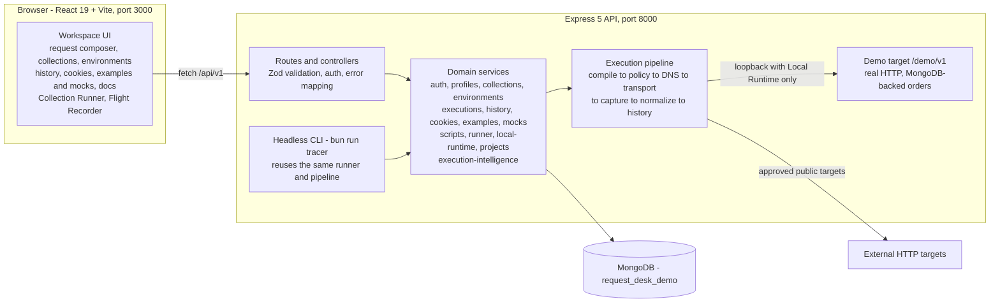
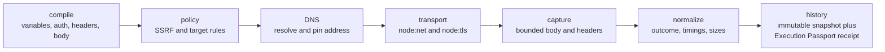
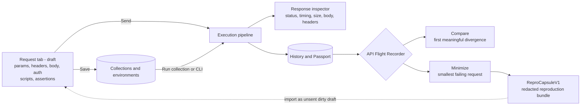

<h1 align="center">Tracer — API Flight Recorder</h1>

<p align="center">
  A keyboard-first HTTP workspace for composing, sending, organizing, and analyzing API requests — with a built-in API flight recorder.
</p>

Tracer is a full-stack React and Express application. Requests execute through the Express API on the server and results are persisted in MongoDB, so a signed-in profile can build a real HTTP request, send it, inspect the response, save it into a collection, switch environments, and reopen it from history.

## API Flight Recorder

When a request works today and fails tomorrow, Tracer answers three questions: *what changed*, *what is the smallest cause*, and *how do I reproduce it safely*. The core flow is:

```text
record → compare → minimize → reproduce
```

Every send **records** an immutable, secret-redacted Execution Passport: compiled request evidence, variable and authentication sources, policy decision, pinned destination, timings, and a response contract. **Compare** two runs to see ordered causal evidence and the first meaningful divergence — request, environment, auth, script, cookie, DNS, policy, or response changes — plus lightweight contract checks for removed fields, type changes, unexpected statuses, and required-header changes. **Minimize** a failure with bounded probes (capped at 12, cancellable, flaky-predicate aware) that remove query rows, headers, and JSON fields until only the smallest reproducing request remains. **Reproduce** from a redacted capsule: export a `ReproCapsuleV1` bundle with placeholders instead of secrets, import it through the same normalized boundary as cURL import, open it as an unsent dirty draft, and send it manually to see the failure again. Importing never auto-Sends and never auto-Saves, and automatic mutating probes run only against approved local or mock targets.

A deterministic end-to-end demo of the whole flow runs against the seeded app:

```bash
bun run demo:flight-recorder
```

## Built With

- [React 19](https://react.dev/) and [Vite 8](https://vite.dev/) for the frontend
- [Bun](https://bun.sh/) as the workspace package manager and JavaScript runtime
- [Express 5](https://expressjs.com/) for the HTTP API
- [MongoDB](https://www.mongodb.com/) and [Mongoose](https://mongoosejs.com/) for persistence
- [Zod](https://zod.dev/) for request validation
- [JSON Web Tokens](https://jwt.io/) and [bcrypt](https://github.com/dcodeIO/bcrypt.js) for sign-in
- Native `node:net` / `node:tls` sockets for target HTTP execution, with no additional HTTP client dependency

## Project Structure

```text
.
├── backend/                     # Express API, business logic, and MongoDB persistence
│   └── src/
│       ├── app.js               # Express application and route mounting
│       ├── index.js             # Startup, restart recovery, and maintenance
│       ├── features/
│       │   ├── auth/            # Sign-in, session, and profile switching
│       │   ├── profiles/        # Profiles and per-profile preferences
│       │   ├── collections/     # Versioned collection aggregates and requests
│       │   ├── environments/    # Named environments and secret references
│       │   ├── executions/      # Compiler, policy, transport, capture, normalization
│       │   ├── history/         # Immutable execution history and receipts
│       │   ├── collection-runner/ # Ordered bounded collection/folder runs
│       │   ├── cli/             # Headless runner and CI-facing CLI
│       │   ├── cookies/         # Profile-scoped cookie jar
│       │   ├── examples/        # Saved response examples
│       │   ├── mocks/           # Deterministic mock matching/routes
│       │   ├── scripts/         # Sandboxed scripts and assertions
│       │   ├── local-runtime/   # Explicit local/private target approvals
│       │   ├── projects/        # Portable TracerProjectV1 model
│       │   ├── git-native/      # Deterministic multi-file project layout
│       │   ├── execution-intelligence/ # Passport, compare, minimize, capsules
│       │   └── demo/            # Real local HTTP targets backed by MongoDB
│       ├── scripts/             # Seed and repository utility scripts
│       └── shared/              # Configuration, middleware, errors, utilities
├── frontend/
│   ├── src/features/            # Workspace, Runner, Flight Recorder, docs, mocks, cookies, etc.
│   ├── src/shared/              # API client, reusable controls, formatting
│   └── public/                  # Local static assets
├── examples/ci/                 # Deterministic CLI/CI proof fixtures
├── design/                      # UI audit and design artifacts
├── docs/                        # Product/design implementation notes
├── skills/validate/             # Acceptance validator
├── DESIGN.md                    # Visual direction and interaction language
├── PRODUCT.md                   # Product identity and scope commitments
├── hackerrank.yml               # HackerRank install/run and packaging contract
├── package.json                 # Bun workspace scripts
├── setup.sh                     # Safe local setup/reset/start entry point
└── transcripts/                 # Exported AI transcripts added at submission time
```

Every backend domain keeps routes, controllers, services, repositories, and models separate. Controllers validate with Zod and map HTTP; services own the rules; repositories are the only code that queries MongoDB.

## Architecture

Tracer is one Bun workspace with two applications and one database. The browser never executes HTTP requests against a target: every send goes through the Express API, so the security policy, secret handling, and evidence capture are enforced in one place.



How the layers fit together:

- **Frontend (`frontend/src`).** `features/` holds one folder per product domain (workspace, import, export, cookies, examples, mocks, scripts, docs, collection-runner, execution-intelligence, and more); `shared/` holds the API client, reusable controls, and formatting. State is plain React state and a workspace reducer: drafts live in the browser and are only persisted when you Save.
- **API (`backend/src`).** Each `features/<domain>/` folder separates routes, controllers, services, repositories, and models. Controllers validate input with Zod and translate errors to HTTP; services hold the rules (ownership, revisions/CAS, limits); repositories are the only MongoDB access. `shared/` carries configuration, auth middleware, error handling, and limits.
- **Execution pipeline (`backend/src/features/executions`).** One pipeline serves manual sends, collection runs, the CLI, and failure minimization. There is no second execution path.



- **Security boundaries.** Target requests carry only request/collection auth plus that profile's cookie jar; application sign-in tokens never reach a target. Private, loopback, and reserved addresses are rejected before dispatch (SSRF boundary), with two explicit exceptions: the seeded demo target and hosts approved through Local Runtime. Secrets are stored as alias references and resolved server-side at send time; every stored or displayed artifact is redacted.
- **Flight Recorder (`backend/src/features/execution-intelligence`).** Every history entry carries an immutable `ExecutionReceiptV1` passport. Compare, Minimize, and Reproduction Capsules build on those receipts as deterministic evidence, never a second transport.
- **Headless CLI (`backend/src/features/cli`).** `bun run tracer` wires the same compiler, policy, transport, and collection runner over in-memory stores, so UI runs and CLI runs are equivalent by construction.

### Execution and analysis flow



Send and Save are deliberately separate: sending executes the draft and records evidence; saving commits it to a collection. Imported cURL, portable projects, and reproduction capsules always open as unsent, dirty drafts — nothing is ever auto-sent or auto-saved.

## Prerequisites

- [Bun](https://bun.sh/) 1.3 or newer
- [MongoDB](https://www.mongodb.com/docs/manual/administration/install-community/) 8.0 or newer, reachable on `127.0.0.1:27017`
- Bash (Linux, macOS, or Git Bash on Windows) to run `setup.sh`

The application targets ports 3000 (frontend) and 8000 (backend). Both values live in `hackerrank.yml` and `frontend/vite.config.js`.

## MongoDB Behavior

Tracer stores everything it needs in the `request_desk_demo` database: accounts, profiles, preferences, collections, environments, demo orders, and execution history.

`setup.sh` refuses to run a destructive seed against any database other than `request_desk_demo` on a local host. It creates missing `.env` files, generates a `JWT_SECRET`, a separate `EXECUTION_FINGERPRINT_KEY`, and demo target tokens on first run, then seeds the baseline.

**Seeded baseline (restored by every full start):**

| Record             | Count                             |
| ------------------ | --------------------------------- |
| Workspace account  | 1                                 |
| Profiles           | 2                                 |
| Collections        | 4 (2 per profile)                 |
| Environments       | 4 (Local and Staging per profile) |
| Preference records | 2                                 |
| Demo orders        | 10 (5 per dataset)                |
| Execution history  | 0                                 |

A full `bun start` intentionally reseeds this baseline. Data survives browser reloads and backend-only restarts (`bun run dev` inside `backend/`), but a full start restores the seeded state.

## Seeded Access

Sign in with the demo account, then choose either profile:

| Email                      | Password      |
| -------------------------- | ------------- |
| `alex.morgan@example.test` | `password123` |

These credentials exist only for local evaluation. Tracer generates its own signing secret, fingerprint key, and demo target tokens at setup time; no secret is committed to the repository.

Each profile owns an **Orders API** collection (with `Read` and `Write` folders and five saved requests) and an **HTTP Examples** collection, plus **Local** and **Staging** environments. Both environments point at the in-process demo target at `http://127.0.0.1:8000/demo/v1`, which serves genuine HTTP responses backed by MongoDB and requires a bearer token.

## Run Instructions

Install dependencies and seed the database:

```bash
bun install && bash setup.sh --seed
```

Start the complete application:

```bash
bun start
```

Then open `http://localhost:3000`.

`bun start` runs `setup.sh --start` first (which reseeds), then starts the Express API on port 8000 with `bun --watch` and the Vite dev server on port 3000. Vite proxies `/api` to the backend.

## Using the Workspace

- **Keyboard.** `Ctrl/Cmd+Enter` sends the active request, `Ctrl/Cmd+S` saves it into its collection, arrow keys move between request, response, and sidebar tabs, and the splitter between the request and response panes resizes with arrow keys (`Enter` resets it).
- **Layout.** Drag the splitter between the request builder and the response to set your own balance; the position is remembered locally. Below 840 px the collection panel becomes an overlay that closes with `Escape`.
- **Brand.** The Tracer symbol and lockup live in `frontend/public/brand/` as original SVGs (symbol, monochrome, light, and dark lockups) with the favicon at `frontend/public/favicon.svg`.
- **Themes.** The header toggle switches dark and light. Both themes derive from the same design tokens in `frontend/src/styles.css`.
- **cURL import.** The header's **Import cURL** button parses a pasted command — URL, method, ordered headers, JSON/text/form body, `--max-time`, and `-u` credentials — previews it with warnings, and opens it as an unsaved draft. Importing never saves or sends. Credentials from `-u` stay a send-only override instead of being stored in the request, and file reads, shell substitution, proxy/TLS options, multipart bodies, and unknown flags are rejected rather than guessed.
- **Generated documentation.** Each collection's **Documentation** action renders docs straight from the saved aggregate: method and URL, query, headers, body, effective auth, variable references, and saved response examples. Variable values are never shown, literal credential text is masked, and the whole document can be copied or downloaded as Markdown. There is no separate documentation store, so docs always describe the last saved state.
- **Cookie jar.** `Set-Cookie` headers from target responses are stored per profile, and matching cookies are sent on later requests to the same host. The **Cookies** sidebar tab lists the jar with domain/path scope, flags, and expiry, and can delete a single cookie or clear the jar. A request that defines its own `Cookie` header is sent exactly as written and skips the jar for that send, with a warning. Malformed attributes fail closed instead of being guessed, and stored cookie values are redacted from history and response bodies.
- **Examples and mocks.** After a send, **Save as example** copies the status, ordered headers (duplicates kept), content type, and body into a profile-scoped example, together with the match rules you select from the request's query parameters and headers. **Mock Send** resolves the current request against those examples on the server and shows the saved response with a clear mock banner: it never dispatches network traffic, never writes history, and never replaces **Send**. Requests that match nothing report a mock miss listing the method, path, and candidate count. **Copy mock URL** copies the profile's capability route (`/api/v1/mocks/<profileId>/<token>`); calls to it match the same rules and return the saved bytes without a session, and a wrong token or another profile's route returns 404. Examples can also be created and edited by hand from the **Examples** sidebar tab.
- **Flight Recorder.** Every history entry has a **Passport** action opening the API Flight Recorder with its **Passport**, **Compare**, **Minimize**, and **Capsule** sections: the immutable execution receipt with request/response fingerprints, a causal **Compare** of any two runs with the first meaningful divergence and contract drift, bounded failure **Minimize** with start/status/cancel, and **Export Capsule** / **Import Capsule** for redacted reproduction capsules that always open as unsent, unsaved dirty drafts.
- **Collection runner.** The **Run collection** and **Run folder** actions open a runner that executes saved requests as one ordered run: pick any subset of requests (the preview shows the exact execution order), repeat the selection for up to 25 iterations, choose an environment, add initial run variables, and either stop at the first failure or continue. Every request is an ordinary execution through the normal compile → policy → DNS → transport → capture → normalize → history pipeline with its own history entry and Execution Passport, so **Passport** and **Compare** open straight from any result row — including failed ones. Variable changes made by scripts propagate deterministically to later requests in run scope and never modify saved environments or collections; initial run variables cannot substitute secret references. Each result row reports status, outcome, assertion counts, duration, and a failure reason, the summary is available after the run, and **Rerun** starts a fresh run with the same selection.
- **Headless CLI.** The same runner is available without the UI via `bun run tracer` (see [Headless CLI](#headless-cli)), which reads a git-native project directory or a portable project file and executes it through the identical pipeline.

## Headless CLI

The CLI reads a git-native project directory or a portable `TracerProjectV1` JSON file and runs it through the identical compile → policy → DNS → transport → capture → normalize → history pipeline. A headless run and a workspace run of the same inputs produce the same ordered steps, assertion counts, outcome, stop reason, and per-step Flight Recorder execution ids.

```bash
bun run tracer validate ./my-project                 # parse and count, send nothing; exit 0 or 2
bun run tracer run ./my-project --collection "Orders API" --environment Local --json
bun run tracer plan ./my-project --environment Local  # resolve and print the plan, send nothing
```

- **Selection.** `--collection`, `--environment`, `--folder`, and repeatable `--request` accept a name or a 1-based index. Requests run in the order given; otherwise folders run before root requests, each in saved order.
- **Determinism.** `--iterations 1..25` repeats the selection, `--stop-on-failure` (the default) stops at the first failure while `--continue` keeps going, and repeatable `--variable KEY=VALUE` seeds an initial run variable. Script-written variables propagate through run scope exactly as in the workspace, and an initial variable can never substitute a secret reference.
- **Secrets without a shell history.** `--variable-env KEY=ENV_VAR` binds a run variable to an environment variable, so the value never appears in `argv` (where `ps` can read it). Secret references also resolve from `SERVER_SECRET_ALIASES_JSON` plus the referenced `DEMO_*` environment variables at run time. Values are never printed, never written to a report, and are already redacted from captured bodies, so `--json` output is safe to archive.
- **Local targets.** The normal SSRF boundary still applies. Each `--allow-local <host>` opts in to one exact loopback/private host through the same approval path as the UI local-runtime setting; without it, a loopback target is refused.
- **Timeouts.** `--timeout <seconds>` (1–3600) bounds the whole run. When the budget is exceeded the in-flight request is cancelled, the report records `timedOut: true`, and the process exits promptly with code `124`.
- **Reports.** `--report <path>` writes the authoritative JSON report and `--junit <path>` writes a dependency-free JUnit XML summary derived from the same report object, so the two artifacts can never disagree. Parent directories are created, and a write failure is a system failure (exit `3`) even when the run itself passed.
- **Output.** stdout always carries the machine document when `--json` is set (otherwise the human report). stderr carries diagnostics, artifact notices, and text-mode errors; in JSON mode a failure prints the JSON document to stdout plus one diagnostic line on stderr. `--json` prints one stable JSON document (`kind: tracer.cli-run`, `tracer.cli-validate`, or `tracer.cli-error`) with the plan, per-step status/outcome/HTTP status/assertion counts/duration/failure reason/execution id, and the run summary.
- **Storage.** There is no separate CLI store: a run uses an in-memory history, cookie jar, and run store, so a headless run never persists into MongoDB.

Exit codes are stable and documented for automation:

| Code  | Meaning                                                  |
| ----- | -------------------------------------------------------- |
| `0`   | the run completed and every executed request passed      |
| `1`   | the run completed but at least one request failed        |
| `2`   | invalid arguments, project, selection, or configuration  |
| `3`   | the runner, the execution pipeline, or report writing failed unexpectedly |
| `124` | the run exceeded the `--timeout` budget                  |
| `130` | the run was cancelled (SIGINT)                           |

### Continuous integration

`examples/ci/` contains a self-contained, database-free proof that the CLI is CI-ready: a deterministic `Bun.serve` target (`target-server.js`), a canonical `TracerProjectV1` fixture (`tracer-project.json`, regenerated with `bun examples/ci/make-project.mjs`), and `ci-demo.sh`, which starts the target, validates the project, runs the passing collection, runs the failing assertion, and asserts exit codes `0` and `1` respectively.

```bash
bash examples/ci/ci-demo.sh   # exit 0 only when every expectation holds
```

The [Tracer CLI workflow](.github/workflows/tracer-cli.yml) runs the same scenario on every pull request: contract tests, `validate`, the passing collection (exit `0`), and the failing collection as a step whose raw `outcome` must be `failure` — proving the non-zero exit came from the CLI — then uploads the JSON and JUnit reports as artifacts. It needs no MongoDB, no hosted service, and no interactive input.

## Command Reference

| Command                 | Purpose                                                        |
| ----------------------- | -------------------------------------------------------------- |
| `bun install`           | Install every workspace package                                |
| `bash setup.sh --seed`  | Prepare environment files, generate secrets, seed the baseline |
| `bash setup.sh --start` | Same as `--seed`, used by `bun start`                          |
| `bun start`             | Seed, then run the API and the frontend together               |
| `bun run seed`          | Reseed the database without starting servers                   |
| `bun run demo:flight-recorder` | Run the deterministic Flight Recorder demo (app must be running) |
| `bun run tracer`        | Headless collection runner (see [Headless CLI](#headless-cli))  |
| `bash examples/ci/ci-demo.sh` | Local pass/fail parity demo for the CLI (no database)      |
| `bun test`              | Run the full test suite (backend + frontend, Bun's built-in runner) |
| `bun run test`          | Backend tests only                                              |
| `cd frontend && bun test` | Frontend tests only                                           |
| `bun run dev:backend`   | Backend only, with reload                                      |
| `bun run dev:frontend`  | Frontend only                                                  |

## Testing

Tests live next to the code they cover as `*.test.js` files and run on Bun's built-in test runner. From the repo root, `bun test` discovers every suite — backend and frontend together. The full suite is 84 test files and 918 tests (640 backend across 60 files, 278 frontend across 24 files), currently green with one intentional skip (the TLS SNI test dials a pinned address and is skipped in local runs).

```bash
bun test                       # everything: 84 files, 918 tests
bun run test                   # backend only (cd backend && bun test)
cd frontend && bun test        # frontend only
```

What the suites cover:

| Area                         | Examples of what is proven                                                                 |
| ---------------------------- | ------------------------------------------------------------------------------------------ |
| Execution core               | request compiler, target/address policy (SSRF), DNS pinning, transport, response capture/normalization, history CAS |
| Persistence & projects       | ownership, revisions/CAS, restart/reset, portable `TracerProjectV1` round-trip, git-native layout, seed reset |
| Cookies, examples, mocks     | Set-Cookie parsing and matching, jar replay through real execution, example persistence, deterministic mock matching |
| Scripts & assertions         | sandbox capability blocks, timeouts, variable writes, assertion semantics and diagnostics |
| Collection Runner            | run plan/order, failure policy, iteration, run summary, variable propagation |
| CLI                          | argument/exit-code contract, JSON/JUnit reports, secret safety (resolved on the wire, never in artifacts), timeouts, CI parity against a real local server |
| Flight Recorder              | execution receipts, run comparison, repro capsules, failure minimizer, end-to-end acceptance |
| Frontend workflows           | workspace reducer and tab/draft workflows, import (cURL) parsing and drafts, export snippets, response body/JSON/markup views, docs model/view, dialog stack, design contracts |

Test infrastructure notes:

- Tests are self-contained: fake adapters or in-process `Bun.serve` targets stand in for the network, so the suite needs no MongoDB and no hosted service.
- `backend/.env` (written by `setup.sh`) is auto-loaded by Bun when tests run inside `backend/`; suites that need their own secret-alias configuration merge it explicitly rather than depending on ambient values.
- Two deterministic end-to-end proofs run outside `bun test`: `bash examples/ci/ci-demo.sh` (CLI pass/fail parity against a local target, no database) and `bun run demo:flight-recorder` (the full Passport → Compare → Minimize → Capsule → Reproduce demo against the seeded app).

Continuous integration runs the same gates on every pull request: the **Baseline Gate** (`.github/workflows/baseline-gate.yml`) runs `bun install --frozen-lockfile`, `bun test`, backend syntax checks, the frontend build, a seeded start with a runtime health smoke; the **Tracer CLI** workflow (`.github/workflows/tracer-cli.yml`) runs the headless runner scenario and uploads JSON and JUnit reports.

## Product Limits and Behavior

- **Execution budget:** 100–30,000 ms per request, 15,000 ms by default. Cancelling stops the local operation; it cannot undo effects that already reached the target.
- **Collection runs:** 1–25 iterations over up to 100 selected requests, 200 executed steps and a 5-minute budget per run, one active run per profile, cancel and rerun at any time.
- **Target policy:** only publicly routable HTTP and HTTPS addresses are permitted. Private, loopback, link-local, multicast, reserved, and NAT64/6to4 addresses are rejected before dispatch, except the seeded demo target on `127.0.0.1:8000/demo/v1`.
- **Body capture:** responses are captured up to 1 MiB encoded and 1 MiB decoded independently. A capture overflow reports the `size_limit` outcome; a history copy keeps at most the first 256 KiB of a body and says so.
- **History retention:** every accepted send writes an immutable snapshot and its terminal outcome. Visible bodies are trimmed beyond the newest 200 completed sends per profile, and records expire after seven days. Deleting history removes stored bodies but keeps a minimal receipt so a duplicate execution id is never dispatched again.
- **Collections:** up to 50 collections per profile, 100 requests and 20 folders per collection, 2 MiB canonical JSON per collection.
- **Environments:** plain variables are stored as written and are visible to anyone who can read the profile. Secret references store only an alias; the value is resolved on the server at send time and never returned to the browser.
- **Cookies:** up to 200 live cookies per profile, 4 KiB per cookie, and 8 KiB for a generated `Cookie` header. Cookies are matched by RFC 6265 domain, path, and Secure rules and are never sent outside their scope, to unrelated hosts, or after expiry. Session cookies (no `Max-Age`/`Expires`) live for the running backend process — a restart drops them, matching a browser session — while cookies with an explicit expiry survive restarts. Expired and stale-session cookies are purged lazily.
- **Examples:** up to 50 examples per profile with unique names, 256 KiB per stored body (live responses are truncated and marked when larger), and at most 100 query-parameter and 100 header match rules. Credential headers (`Authorization`, `Cookie`, `Set-Cookie`, `Proxy-Authorization`, `X-API-Key`) are rejected as match rules, and mock routes carry an unguessable per-profile token instead of a session.

Tracer never sends application sign-in tokens to a target. Target requests carry only the credentials you configure through request or collection authentication, plus cookies stored in that profile's own jar from target responses.
