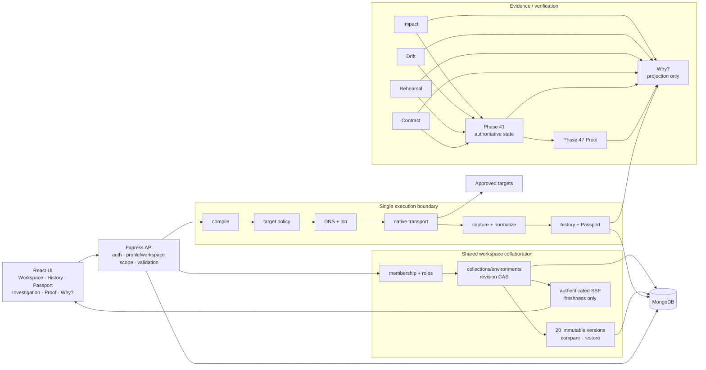

# Tracer Reviewer Guide

This document is the fastest way to understand and demo the shipped product.

## 10-second story

**Tracer is an API change-safety workspace.**

A developer changes an API request, variable, auth setting, collection, or environment. Tracer answers:

1. **What can this change affect?**
2. **Can the affected workflow still run in the target environment?**
3. **Did environment drift or a response-contract break block it?**
4. **What evidence supports the final technical state?**
5. **What human review decision was made beside that state?**

```text
Change → Impact → Rehearse → Verify → Review
```

That is the story to say first. Everything else in Tracer exists to make one of those five steps trustworthy.

> **Current browser-scope caveat:** the five-step chain is the intended product architecture, but the current repository does **not** yet prove the entire `Impact → Drift → Rehearsal → Contract → Verification Proof` generation path as one complete browser workflow. Impact/Drift/Rehearsal/Contract are backed by shipped cores and targeted tests, while Proof/Why? can inspect linked evidence. Issue #71 remains open for the missing browser-generation path, so do not present the product as fully browser end-to-end or fully submission-ready.

## 30-second pitch

Start with a normal API workspace: compose requests, save collections, use environments, send, and inspect responses.

Tracer adds the change-safety loop. When workspace state changes, **Impact** narrows the requests and references that may be affected. **Rehearsal** runs that affected workflow against the target environment through the normal execution pipeline. **Verification** combines the recorded rehearsal, environment-drift, and contract evidence into `VERIFIED`, `BLOCKED`, `NEEDS_REHEARSAL`, or `UNKNOWN`, then produces a tamper-evident Verification Proof. **Reviews** carries that exact proof into the human decision without changing the machine result.

If something fails, **Why?** and Investigation explain the exact configuration and execution evidence behind it. If another developer edits the same workspace, collaboration keeps versions, conflicts, and restores explicit instead of silently merging over them.

## Submitted capability scope

For HackerRank scope, present Tracer as **10 core capabilities**:

1. Request authoring & execution
2. Collections & generated documentation
3. Environment management
4. Authentication & session state
5. Response analysis & history
6. Automated testing & multi-request runs
7. Examples & deterministic mocks
8. Workspaces, collaboration & versioning
9. Flight Recorder & investigation
10. Change verification & human review

Do **not** count implementation controls such as cURL import, code snippets, cookies, assertions, CLI, versions, Impact, Drift, Rehearsal, Contract, Proof, Why?, or Reviews as separate top-level products. The ten-item list is a **scope grouping**. It does not mean every grouped control currently has a complete browser end-to-end journey; see issue #71 and `docs/project-history-reconciliation.md`.

## What to show first

If a reviewer only gives you two minutes:

1. Say the five-step story once: **“Change → Impact → Rehearse → Verify → Review.”**
2. Send **Orders API → Read → List orders** to establish that this is a real API workspace, not a diagram.
3. Open **History → Why?** and show that Tracer records the effective configuration, variable/auth provenance, execution stages, and explicit unknown evidence instead of guessing.
4. Cross-link to **Passport** to show the immutable execution record that later impact/verification evidence can cite.
5. Explain: **“This evidence is what lets Tracer verify a changed workflow and carry the exact result into review; React never invents the verification state.”**

Do not start by listing every Postman-like feature or every internal phase. The reviewer should understand the job first; the implementation depth comes second.

## Five-minute differentiator demo

### 1. Execute

Send a seeded Orders request.

Point out that every send passes through one backend-owned pipeline:

```text
compile → policy → DNS → transport → capture → normalize → history
```

The browser never sends arbitrary target HTTP directly.

### 2. Understand

Open the **Execution Passport**.

Show:

- compiled request evidence,
- variable/auth sources,
- target-policy decision,
- timings,
- response contract,
- secret-redacted identity.

The Passport is evidence from the actual execution, not a reconstruction from today's editable request.

### 3. Investigate

Compare a passing and failing execution.

Explain the distinction:

- **first divergence / correlated change** = evidence worth inspecting;
- **verified cause** = an intervention actually reproduced the failure and reversing it removed the failure.

Tracer deliberately does not turn chronology into causation.

Use **Minimize** to reduce a failing request under a bounded probe budget, then export a redacted reproduction capsule. Import opens an **unsent, unsaved draft**.

### 4. Verify

The verification story is:

```text
edit
 ↓
snapshot identity
 ↓
impact
 ↓
drift
 ↓
rehearsal
 ↓
contract compatibility
 ↓
Phase 41 verification
 ↓
Verification Proof
```

Important: the shipped verification artifacts bind to an explicit snapshot identity/fingerprint. Do not describe a separate persisted snapshot product surface where one was not recorded.

### 5. Explain the result

Open **Why? → Evidence**.

Without a linked Phase 41 result, verification stays **UNKNOWN**.

Attach an exported Verification Proof for this read only. The artifact goes to the backend; React does not validate or persist it.

Then show:

```text
Configuration
 ↓
Execution
 ↓
Impact
 ↓
Drift
 ↓
Rehearsal
 ↓
Contract
 ↓
Phase 41 Verification
 ↓
Phase 47 Proof
```

Point out explicit link states:

- `not_recorded`
- `identity_mismatch`
- `STALE`
- `INVALID`

A stale proof is never painted as a current green pass.

### 6. Collaboration and versioning

> Tracer provides persisted workspace sharing, roles, version history, and conflict-safe saved-state synchronization. The required HackerRank product path does not depend on multiple simultaneous signed-in browser sessions.

For the normal single-session reviewer path, use Alex's compact **Workspace** rail command to open **Manage workspace**, inspect the seeded Alex/Jordan membership and roles, open its **Activity** section, then open a collection's **Versions** view to compare or restore a prior revision.

For optional local evidence of live synchronization, use two signed-in browsers (Alex OWNER, Jordan EDITOR) in **API Platform Team**:

```text
Jordan edits → Alex receives the live change → compare versions → concurrent conflict → restore old version as new revision
```

1. Jordan saves the shared collection → Alex's UI follows the tip with a toast, no reload.
2. Alex opens **Versions** from the collection menu, selects v1, and compares structured paths (`requests[id=…].method`) against current.
3. Alex dirties a request draft; Jordan saves again → Alex keeps the draft and gets a remote-change banner (Compare / Reload remote / Keep editing).
4. Alex saves the stale draft → the attributed 409, then Reload.
5. Alex restores v1 → a new revision (v4), never a history rewrite; Jordan sees v4 live.
6. Demote Jordan to VIEWER → controls go read-only immediately; remove Jordan → the stream closes and the client falls back to an authorized workspace.

Version snapshots hold the saved canonical definition only: `secretRef` aliases without values, reference-only auth templates, and redacted header/query credentials.

## Architecture in one diagram



## Truth ownership

| Output | Who owns it? | What the UI may do |
| --- | --- | --- |
| Effective request/configuration | compiler + execution receipt | display provenance |
| Execution facts | execution pipeline/history | display |
| Investigation conclusion | investigation engine | display evidence/reason |
| Impact | Phase 39 | display |
| Drift | Phase 40 | display |
| Contract compatibility | Phase 43 | display |
| Rehearsal/run state | Phase 46 | display |
| VERIFIED / BLOCKED / NEEDS_REHEARSAL / UNKNOWN | **Phase 41** | display only |
| Proof integrity/currentness | Phase 47 | display only |
| Why explanation | Why read-model | compose existing evidence only |
| Shared workspace membership / role | workspace service + persisted membership | display backend capabilities |
| Saved collection/environment revision | resource CAS in backend services | keep local draft, never silently merge |
| Version history / restore | immutable version rows + CAS restore | inspect/compare/request restore |
| Live update event | SSE broker (advisory only) | reload canonical state |
| Human review decision (APPROVED / CHANGES_REQUESTED / WAIVED) | **review participants** (OWNER/EDITOR) | record beside evidence; never rewrite it |
| Review freshness (CURRENT / STALE) | frozen-evidence comparison | display; re-review from current evidence |

The rule to remember:

> **Missing evidence never becomes a pass.**

> **Machines determine technical truth; humans determine what the team chooses to do about that truth.** `technicalState != reviewDecision`: a `WAIVED` review on `BLOCKED` evidence still displays BLOCKED.

## Why this is not just a Postman clone

Tracer's submitted scope is the ten-capability inventory above. Familiar API-client controls and the deeper evidence machinery are supporting parts of those workflows, not extra feature claims.

The product thesis is:

> **A request should be explainable after it executes, diagnosable after it fails, and verifiable after it changes.**

The two main differentiating capabilities are **Flight Recorder & investigation** and **Change verification & human review**. Their internal evidence steps remain visible because they make the result trustworthy, but they are not presented as separate submission features.

### Review queue in one minute

Open a Verification Proof and use **Promote to Review** on the committed BREAKING contract, BLOCKED/UNKNOWN verification, or proof itself. Tracer carries the exact validated artifact directly into the Reviews form; the reviewer edits only human metadata such as title, summary, and assignee. Choose **Reviews** from the compact Workspace command in the permanent rail; the contextual resource panel then shows the Needs Attention queue. Manual promotion remains available for imported proof artifacts. In every path, the backend derives machine-owned technical state and evidence fingerprints, so a reviewer cannot type a fake BREAKING/BLOCKED state into existence. Open a review to see four sections — **Finding | Evidence | Discussion | Decision**. Approve or waive a `BLOCKED` item and watch the technical state stay `BLOCKED`: the decision is recorded beside the evidence, never over it. Change the underlying resource and recheck freshness: persisted resource revisions are checked directly; for stateless verification/contract/drift evidence, provide the current Verification Proof so Tracer compares validated identities rather than trusting caller-supplied fingerprints. The review goes `STALE` with changed fields named, old comments and decisions intact, and **Create re-review** requires current proof evidence and links a fresh review forward.

## Likely reviewer questions

### “Why not let the frontend compute verification?”

Because verification is a trust boundary. If React can recompute or upgrade the state, two clients could disagree about whether the same evidence is safe. Phase 41 owns the state; the UI only renders it.

### “What happens when evidence is missing?”

Tracer fails closed. Missing Phase 41 evidence means `UNKNOWN`, not VERIFIED. Missing links appear as `not_recorded`; mismatched identities remain visible instead of being joined heuristically.

### “Why does Why? need a proof attachment?”

Proof artifacts are intentionally not persisted server-side by the proof import flow. The Why dialog can attach one for a single read. The backend's existing Phase 47 importer verifies it; the browser stores it only in component state.

### “What does STEP_IN_DOUBT mean?”

It protects mutating rehearsal steps from blind replay. If a remote side effect may have occurred but the durable checkpoint is ambiguous, Tracer stops rather than claiming exactly-once remote behavior it cannot prove.

### “Is the live collaboration Google-Docs-style realtime editing?”

No. Tracer synchronizes **saved resource state**, roles, membership and activity live. It intentionally does not synchronize keystrokes or cursors. If Alex and Jordan edit the same saved request concurrently, each keeps their own local draft; the first valid CAS save wins and the stale save receives an attributed `409`. That is safer for an API-development tool than silently merging request definitions.

### “What if an SSE event is missed?”

Nothing authoritative is lost. SSE is a freshness signal only. On reconnect the client reloads canonical workspace state from the API; persisted MongoDB resources, version rows and activity are the source of truth. The in-process broker is appropriate to this single-process assessment runtime and is not presented as multi-instance pub/sub.

### “Can one collaborator see another collaborator's execution history or secrets?”

No. Saved collection/environment definitions are workspace-shared, but execution History/Passport/Investigation remains profile-scoped. Environment `secretRef` aliases may be shared as definitions; resolved credential values remain profile-authorized and are never copied into versions, activity or live event payloads.

### “Are you claiming enterprise compliance?”

No. Security & Safety, Data Handling, and Responsible Use document implemented behavior. The project does not claim SOC 2, GDPR certification, penetration-test certification, or production legal review.

### “Is every architecture document current?”

`ASTRA_ARCHITECTURE.md` is intentionally the frozen **pre-implementation design record** from September 17. The current shipped architecture is described in the README and this guide.

## Honest limitations

- Proof import/attachment is inspection-only and read-scoped; Tracer does not persist an imported proof merely to make Why? easier.
- If evidence from Impact/Drift/Verification/Proof is not available or cannot be identity-linked, Why? reports that gap.
- The final submission-readiness report documents host-specific rerun limitations separately; do not replace those historical results with stronger claims.
- Live collaboration uses an in-process authenticated SSE broker with bounded replay. It is deliberately suitable for the single backend process used by this assessment; multi-instance deployment would require an external pub/sub layer.
- Collaboration is saved-state synchronization, not CRDT/OT character-level co-editing.
- The project is designed for local evaluation and HackerRank assessment constraints, not as a claim of a hosted multi-tenant commercial SaaS.

## Demo account

After `bun start`:

- Frontend: `http://localhost:3000`
- Backend: `http://localhost:8000`
- Email: `alex.morgan@example.test` (team workspace `OWNER`)
- Password: `password123`
- Second account: `jordan.lee@example.test` / `password123` (team workspace `EDITOR`)

Both accounts are members of the seeded **API Platform Team** workspace. The required HackerRank walkthrough uses one signed-in browser. A private/incognito window with the second account is optional local evidence for live saved-state synchronization; it is not required for the application to install, start, or demonstrate its core workflows.

## Useful commands

```bash
bun install --frozen-lockfile
bash setup.sh --seed
bun start

bun test
bun run demo:flight-recorder
bun run demo:investigation
bun frontend/scripts/phase24b-live-e2e.mjs  # two-browser live collaboration proof (app running)
```

For exact final acceptance evidence and caveats, read:

- `docs/final-submission-readiness.md`
- `docs/phase49/why-inspector.md`
- `docs/collaboration-verification.md`
