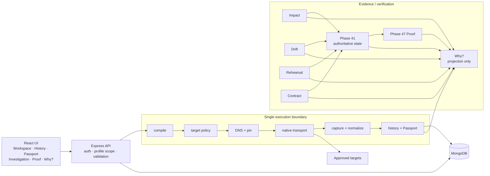

# Tracer Reviewer Guide

This document is the fastest way to understand and demo the shipped product.

## 30-second pitch

**Tracer is an API execution, investigation, and change-verification workspace.**

A conventional HTTP client answers: *what did this request return?*

Tracer continues:

1. **How exactly did it execute?**
2. **What changed when it stopped working?**
3. **What does this change affect?**
4. **Can the affected workflow be rehearsed safely?**
5. **What evidence makes this state VERIFIED, BLOCKED, NEEDS_REHEARSAL, or UNKNOWN?**
6. **Why did Tracer reach that result?**

The request builder is the substrate. The differentiator is the evidence system around each execution.

```text
Execute → Understand → Compare → Verify
   \____________ Why? ____________/
```

## What to show first

If a reviewer only gives you two minutes, do this:

1. Send **Orders API → Read → List orders**.
2. Open **History → Why?**.
3. Show:
   - effective configuration,
   - where variables/auth came from,
   - ordered execution stages,
   - explicit missing/unknown evidence instead of guessed conclusions.
4. Cross-link to **Passport**.
5. Explain: **“React never decides that this execution is verified. Phase 41 is the authority; Why? only explains recorded evidence.”**

That single path demonstrates the central product idea better than walking through every Postman-like feature.

## Five-minute differentiator demo

### 1. Execute

Send a seeded Orders request.

Point out that every send passes through one backend-owned pipeline:

```text
compile → policy → DNS → transport → capture → normalize → history
```

The browser never sends arbitrary target HTTP directly.

### 2. Understand

Open the **Execution Passport**.

Show:

- compiled request evidence,
- variable/auth sources,
- target-policy decision,
- timings,
- response contract,
- secret-redacted identity.

The Passport is evidence from the actual execution, not a reconstruction from today's editable request.

### 3. Investigate

Compare a passing and failing execution.

Explain the distinction:

- **first divergence / correlated change** = evidence worth inspecting;
- **verified cause** = an intervention actually reproduced the failure and reversing it removed the failure.

Tracer deliberately does not turn chronology into causation.

Use **Minimize** to reduce a failing request under a bounded probe budget, then export a redacted reproduction capsule. Import opens an **unsent, unsaved draft**.

### 4. Verify

The verification story is:

```text
edit
 ↓
snapshot identity
 ↓
impact
 ↓
drift
 ↓
rehearsal
 ↓
contract compatibility
 ↓
Phase 41 verification
 ↓
Verification Proof
```

Important: the shipped verification artifacts bind to an explicit snapshot identity/fingerprint. Do not describe a separate persisted snapshot product surface where one was not recorded.

### 5. Explain the result

Open **Why? → Evidence**.

Without a linked Phase 41 result, verification stays **UNKNOWN**.

Attach an exported Verification Proof for this read only. The artifact goes to the backend; React does not validate or persist it.

Then show:

```text
Configuration
 ↓
Execution
 ↓
Impact
 ↓
Drift
 ↓
Rehearsal
 ↓
Contract
 ↓
Phase 41 Verification
 ↓
Phase 47 Proof
```

Point out explicit link states:

- `not_recorded`
- `identity_mismatch`
- `STALE`
- `INVALID`

A stale proof is never painted as a current green pass.

## Architecture in one diagram



## Truth ownership

| Output | Who owns it? | What the UI may do |
| --- | --- | --- |
| Effective request/configuration | compiler + execution receipt | display provenance |
| Execution facts | execution pipeline/history | display |
| Investigation conclusion | investigation engine | display evidence/reason |
| Impact | Phase 39 | display |
| Drift | Phase 40 | display |
| Contract compatibility | Phase 43 | display |
| Rehearsal/run state | Phase 46 | display |
| VERIFIED / BLOCKED / NEEDS_REHEARSAL / UNKNOWN | **Phase 41** | display only |
| Proof integrity/currentness | Phase 47 | display only |
| Why explanation | Why read-model | compose existing evidence only |

The rule to remember:

> **Missing evidence never becomes a pass.**

## Why this is not just a Postman clone

Tracer still has the substrate expected from an HTTP client: requests, collections, environments, history, response inspection, runner, import/export, cookies, examples, mocks, CLI, and related workflows.

But the product thesis is different:

> **A request should be explainable after it executes, diagnosable after it fails, and verifiable after it changes.**

The differentiators are the linked evidence workflows:

- Execution Passport / Flight Recorder
- evidence-driven Investigation
- bounded minimization + reproduction capsule
- impact and drift evidence
- checkpointed rehearsal with fail-closed uncertainty
- contract compatibility
- authoritative cross-environment verification
- tamper-evident Verification Proof
- WHY Inspector across the full chain

## Likely reviewer questions

### “Why not let the frontend compute verification?”

Because verification is a trust boundary. If React can recompute or upgrade the state, two clients could disagree about whether the same evidence is safe. Phase 41 owns the state; the UI only renders it.

### “What happens when evidence is missing?”

Tracer fails closed. Missing Phase 41 evidence means `UNKNOWN`, not VERIFIED. Missing links appear as `not_recorded`; mismatched identities remain visible instead of being joined heuristically.

### “Why does Why? need a proof attachment?”

Proof artifacts are intentionally not persisted server-side by the proof import flow. The Why dialog can attach one for a single read. The backend's existing Phase 47 importer verifies it; the browser stores it only in component state.

### “What does STEP_IN_DOUBT mean?”

It protects mutating rehearsal steps from blind replay. If a remote side effect may have occurred but the durable checkpoint is ambiguous, Tracer stops rather than claiming exactly-once remote behavior it cannot prove.

### “Are you claiming enterprise compliance?”

No. Security & Safety, Data Handling, and Responsible Use document implemented behavior. The project does not claim SOC 2, GDPR certification, penetration-test certification, or production legal review.

### “Is every architecture document current?”

`ASTRA_ARCHITECTURE.md` is intentionally the frozen **pre-implementation design record** from September 17. The current shipped architecture is described in the README and this guide.

## Honest limitations

- Proof import/attachment is inspection-only and read-scoped; Tracer does not persist an imported proof merely to make Why? easier.
- If evidence from Impact/Drift/Verification/Proof is not available or cannot be identity-linked, Why? reports that gap.
- The final submission-readiness report documents host-specific rerun limitations separately; do not replace those historical results with stronger claims.
- The project is designed for local evaluation and HackerRank assessment constraints, not as a claim of a hosted multi-tenant commercial SaaS.

## Demo account

After `bun start`:

- Frontend: `http://localhost:3000`
- Backend: `http://localhost:8000`
- Email: `alex.morgan@example.test` (team workspace `OWNER`)
- Password: `password123`
- Second account: `jordan.lee@example.test` / `password123` (team workspace `EDITOR`)

Both accounts are members of the seeded **API Platform Team** workspace. Use a
private/incognito window for the second account to see the same shared
collections and environments from an independently authenticated session, and
the workspace **Manage** dialog as Alex to change Jordan's role, remove, or
re-add them.

## Useful commands

```bash
bun install --frozen-lockfile
bash setup.sh --seed
bun start

bun test
bun run demo:flight-recorder
bun run demo:investigation
```

For exact final acceptance evidence and caveats, read:

- `docs/final-submission-readiness.md`
- `docs/phase49/why-inspector.md`
